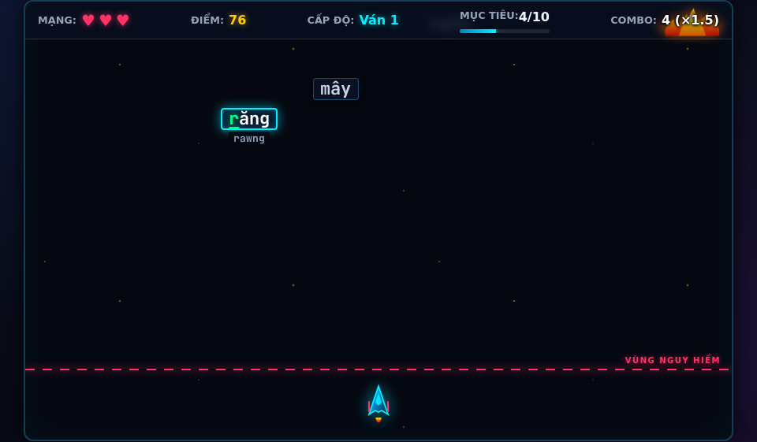

<div align="center">

# 🚀 Space Typer

**Game luyện gõ phím bắn tàu vũ trụ — gõ đúng từ để bắn hạ, sống sót qua từng ván.**

[**▶ Chơi ngay**](https://hieupenguinnn.github.io/typing-game/)



</div>

## Cách chơi

- Các từ rơi từ trên xuống. **Gõ chữ cái đầu** để khóa mục tiêu, gõ tiếp hết từ để bắn nổ.
- **Space** - đổi sang từ khác (bỏ tiến trình đang gõ dở, không bị trừ gì).
- **Gõ sai** - từ lao xuống nhanh gấp 3, phải gõ lại từ đầu, mất combo.
- Từ chạm vạch nguy hiểm - **mất 1 ❤️**. Hết 3 tim là thua.
- Hạ đủ số từ để qua ván, nhấn **Space** để vào ván tiếp theo.

## Độ khó

| Ván | Từ cần hạ | Tốc độ rơi |
|:-:|:-:|:-:|
| 1 | 10 | 100% |
| 2 | 13 | +15% |
| 3 | 16 | +30% |
| 4 | 17 | +45% |
| 5+ | +1 mỗi ván | +15% mỗi ván |

## Tính điểm

```
Điểm 1 từ   = (10 + 2 × độ dài từ) × hệ số combo
Thưởng ván  = 50 × số ván vừa qua + 25 × số tim còn lại
```

| Combo | 0–2 | 3–4 | 5–7 | 8+ |
|---|:-:|:-:|:-:|:-:|
| Hệ số | ×1 | ×1.5 | ×2 | ×3  🔥 |

Gõ sai hoặc để từ chạm đáy thì combo về 0. Không bao giờ bị trừ điểm.

## Bảng xếp hạng

- **Xếp hạng điểm** — kỷ lục cao nhất của mỗi người chơi, lọc theo ngôn ngữ. Hòa điểm thì xét ván cao hơn → nhiều từ đúng hơn → chơi trước.
- **Xếp hạng các ván đã chơi** — số lượt chơi trong 24 giờ và tổng cộng.

---

<div align="center">

### Chúc bạn chơi game vui vẻ! 🎮✨

</div>
